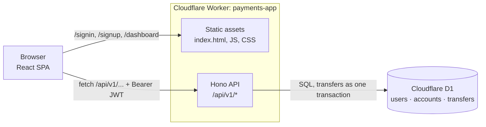

# Paytm Wallet Clone: `hono_paytm` (edge deployment)

**Live:** https://payments-app.address-book.workers.dev

This branch is the deployable version of the wallet app on `main`. The same React frontend is served by
a **Hono** API on **Cloudflare Workers**, with **Cloudflare D1** (SQLite) as the database. `main` keeps the
original Express + MongoDB version; this branch is where it runs in production.

It's a demo: every account starts with a random test balance between ₹1 and ₹10,000, and no real money is involved.

## How it runs



- **One origin, no CORS.** Pages and API share one origin. `/api/*` goes to Hono
  (`assets.run_worker_first`), and everything else is a static file. Unknown paths fall back to `index.html`, so
  `/dashboard` survives a refresh.
- **Stateless auth.** Sign-in returns a JWT (HS256, 7-day expiry) that the frontend stores and sends as
  `Authorization: Bearer ...`. The signing key is a Worker secret.
- **Atomic transfers.** The debit, the credit and the transfer record are sent as one D1 `batch()`, which runs
  as a single SQL transaction. The table constraints are the checks: `CHECK (balance >= 0)` rejects an
  overdraft and the foreign keys reject a missing account. Either one rolls back the whole transfer. The balance
  check and the debit are the same statement, so two transfers sent at the same moment can't spend the same money.

## From Express + MongoDB (`main`) to Hono + D1 (here)

| `main` | Here | Why |
| --- | --- | --- |
| `backend/index.js` (Express app, `cors()`, error middleware) | `src/worker/index.ts` (Hono, `app.onError`) | Hono runs on Workers; one origin means no CORS |
| `backend/routes/user.js`, `account.js` | `src/worker/routes/user.ts`, `account.ts` | same endpoints, same request and response shapes |
| `backend/middleware.js` + `jsonwebtoken` | `src/worker/middleware.ts` + `hono/jwt` | `hono/jwt` uses Web Crypto, which Workers provide |
| `bcrypt` | PBKDF2-SHA256 via Web Crypto (`utils/password.ts`) | `bcrypt` is a native addon; pure-JS `bcryptjs` costs ~70 ms of CPU per hash, over the free plan's 10 ms |
| `db.js` Mongoose models | `migrations/0001_init.sql` | D1 is Cloudflare's built-in SQL database: no connection strings, no cluster to keep alive |
| `session.startTransaction()` → `$inc` ×2 → `commitTransaction()` | `DB.batch([debit, credit, insert transfer])` | one transaction, with the checks enforced by the database |
| `localhost:3000` in each `fetch` | relative `/api/v1/...` | same origin in dev and in production |

The React components in `src/client` are the same as on `main` apart from the fetch URLs and the fixes below.

### Fixed while porting

Found while porting and testing; `main` still behaves the old way.

- **Negative transfers.** `{"amount": -500}` passed the balance check and moved money *to* the sender. Amounts must now be whole rupees above 0.
- **Self-transfers, decimal amounts and string amounts** are rejected with a clear message.
- **User search was public** and returned every user's email. It now needs a token, excludes you, and returns only names and ids.
- **Search text was used as a regex.** Typing `(` broke the search, and patterns like `(a+)+$` could make every query crawl. It's now a plain `LIKE` with wildcards escaped.
- **Sign-in accepted objects** such as `{"$gt": ""}` as the username. All inputs are validated with zod.
- **Signup could leave a user without a wallet** if the second write failed. Both rows are now written in one transaction.
- **Redirect loop on a bad or expired token.** The dashboard bounced between `/signin` and `/dashboard` forever. It now clears the token first.
- **Email enumeration by timing.** Unknown emails now take as long to reject as wrong passwords.

## API

All routes are under `/api/v1`. Errors look like `{ "success": false, "message": "..." }`.

| Method | Endpoint | Body / query | Auth |
| --- | --- | --- | --- |
| `POST` | `/user/signup` | `{ username (email), firstname, lastname, password }` → `{ token }` | no |
| `POST` | `/user/signin` | `{ username, password }` → `{ token }` | no |
| `PUT` | `/user/update` | any of `{ firstname, lastname, password }` | yes |
| `GET` | `/user/bulk` | `?filter=` (matches first or full name) → `{ users: [{ _id, firstname, lastname }] }` | yes |
| `GET` | `/account/user-info` | → `{ balance, firstname, lastname, username, userid }` | yes |
| `POST` | `/account/transfer` | `{ amount (whole ₹), to (user id) }` | yes |
| `GET` | `/api/health` | checks the database connection | no |

## Layout

```
src/
  worker/
    index.ts            Hono app: middleware, /api/v1 routes, error handler
    routes/user.ts      signup, signin, update, bulk
    routes/account.ts   user-info, transfer
    middleware.ts       JWT sign + auth middleware
    utils/              AppError, zod body parsing, password hashing
  client/               React app from main (App.jsx, components/)
migrations/             D1 schema (SQL)
index.html              Vite entry
wrangler.jsonc          Worker name, assets mode, D1 binding
vite.config.ts          React + Tailwind + Cloudflare plugin
```

## Run it

Requires Node 20+.

```bash
npm install                    # also generates worker-configuration.d.ts (wrangler types)
cp .dev.vars.example .dev.vars # then put a random JWT_SECRET in it: openssl rand -base64 32
npm run db:migrate:local       # create the tables in the local D1 database
npm run dev                    # React + the Hono API in workerd, on http://localhost:5173
```

The local database lives in `.wrangler/state` and is separate from production.

### Deploy to your own Cloudflare account

```bash
npx wrangler login
npx wrangler d1 create payments-app-db    # put the printed database_id in wrangler.jsonc
# set account_id in wrangler.jsonc to your own (and `name` if you like)
npm run db:migrate:remote
npm run deploy
openssl rand -base64 32 | npx wrangler secret put JWT_SECRET
```

## Stack

Hono 4 · Cloudflare Workers + static assets · Cloudflare D1 · Web Crypto (PBKDF2, HS256 JWT) · zod 4 ·
Vite 8 · `@cloudflare/vite-plugin` · React 19 · React Router 7 · Tailwind CSS 4 · TypeScript 5.9
